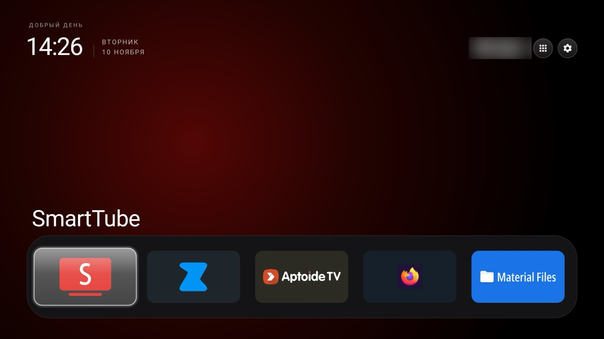

# Clean Your TV for Android 5.1

A clean, fast home screen for old Android 5.1 TV boxes, tested on real hardware.
A port of the [Clean Your TV](https://github.com/Gathin23/cleanyourtv) launcher, which itself needs Android 8 or newer.

**[⬇ Download the APK (v3.4, 0.8 MB)](https://github.com/aliaksandrshandrokha/cleanyourtv/releases/download/v3.4-android5.1/cleanyourtv-android5.1-v3.4.apk)**
· [Install](#install) · [Settings](#settings) · [Uninstall](#uninstall)



## Why

Boxes like the M8S+, MXQ or T95 still run Android 5.1 with a slow stock launcher full of dead tiles.
The original Clean Your TV launcher won't install on them. This fork does, and it is tuned for how these boxes
actually look and work:

- **Runs on Android 5.1.** Every system call newer than Android 5.1 has a fallback, so nothing crashes on a missing feature.
- **Fits the screen.** These boxes draw 1080p at 240 dpi. Tiles, columns and the dock were re-tuned for it.
- **Shows all your apps.** Boxes ship ordinary phone apps, so every installed app can go on Home, not only TV apps.
- **Stays small.** Under 1 MB, no internet permission, no tracking, no background services.

## What you get

| | |
|---|---|
| **Dock** | Your apps in one row. Scroll left and right when you have more than fit. |
| **App library** | The grid button at the top lists every installed app. Press OK on one to put it on Home. |
| **Tile menu** | Hold OK on a tile to move it, remove it from Home or open its app info. |
| **Top bar** | Greeting, clock, date, network and Settings. |
| **Launcher settings** | Hold OK on the Settings button. |

## Tested on

An **M8S+** box, Android 5.1.1, 1.6 GB RAM, 1080p, with its own remote:

- becomes the default Home and comes back on the Home key and after closing an app;
- the remote moves through the dock, the top bar and the App library from every edge;
- the App library lists all apps and adds them to Home; the dock scrolls when full.

Found a box where something misbehaves? [Open an issue](https://github.com/aliaksandrshandrokha/cleanyourtv/issues) with its model and Android version.

## Install

You need a computer on the same network as the box, with [ADB](https://developer.android.com/tools/releases/platform-tools) installed.

1. **On the box:** Settings → About → press OK on **Build** seven times. Go back to **Developer options** and
   turn on **USB debugging** (and **ADB over network** if the box has it). Note the box's IP address in the network settings.
2. **On the computer:** download [the APK](https://github.com/aliaksandrshandrokha/cleanyourtv/releases/download/v3.4-android5.1/cleanyourtv-android5.1-v3.4.apk),
   then run the two commands below with your box's IP address. Accept "Allow USB debugging?" on the TV.
3. **On the box:** press **Home** on the remote, choose **Home** and then **Always**.

```bash
adb connect 192.168.1.50:5555
```

```bash
adb install -r cleanyourtv-android5.1-v3.4.apk
```

No choice appears when you press Home? The stock launcher is still the default: Settings → Apps → stock launcher →
**Clear defaults**, then press Home again.

## Settings

Columns, dock size and the other options live in
[`launcher/app/src/main/res/values/config.xml`](launcher/app/src/main/res/values/config.xml). Change it, then build and install
(needs JDK 17 and Android SDK platform 34):

```bash
cd launcher && ./gradlew :app:assembleRelease && adb install -r app/build/outputs/apk/release/app-release.apk
```

What this fork changed, and what Android 5.1 can't do, is in [ANDROID5.md](ANDROID5.md).

## Clean up the box (optional)

Hide stock apps you never use. Nothing is deleted, and each one comes back with `unhide`:

```bash
adb shell pm hide com.android.vending
```

```bash
adb shell pm unhide com.android.vending
```

Hide one app at a time and only what you're sure about. Keep the stock launcher as a fallback.

## Uninstall

The box goes back to its stock home screen:

```bash
adb uninstall com.gathin.tvhome
```

## Credits and licence

Based on [Clean Your TV](https://github.com/Gathin23/cleanyourtv) by Gathin. MIT, see [`LICENSE`](LICENSE).
The Outfit typeface is under the SIL Open Font License (`launcher/FONT-LICENSE-OFL.txt`).
Not affiliated with any box or TV maker; use it on a device you own, at your own risk.
